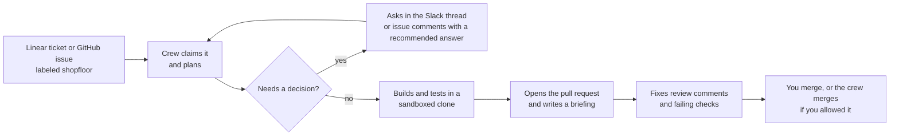
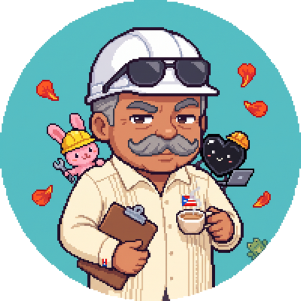

<p align="center">
  
</p>

<h1 align="center">Shopfloor</h1>

<p align="center"><b>Label a ticket. Get a pull request.</b></p>

<p align="center">
  <a href="https://github.com/afvr94/shopfloor/actions/workflows/test.yml"></a>
  <a href="LICENSE"></a>
  
  
</p>

Shopfloor runs crews of [Claude Code](https://docs.claude.com/en/docs/claude-code) sessions on your own machine. Put the `shopfloor` label on a Linear ticket or GitHub issue and a crew picks it up, plans it in a Slack thread or on the GitHub issue, builds it in its own clone of your repo, opens a pull request and keeps it moving until it lands. You steer from the thread. Every pull request comes with a briefing page that explains the change to you, so you stay on top of code you didn't write.

No server, no SaaS, no dependencies: plain Python standard library plus Claude Code skills. A crew wakes on a schedule (launchd on macOS, systemd on Linux), does one round of work and exits.

## A ticket's life



## What it feels like



Every crew has a voice. Name it whatever you like with `voice.name`; this one is **the Foreman**, who runs the floor. Here he is in a made-up thread for a made-up ticket:

> **Foreman** · ENG-42 *Add a CSV export to the reports page*
> Picked this up. Plan: a `GET /reports/:id/export.csv` endpoint next to the JSON one, reusing `ReportQuery`, plus a button on the report header. One question first: should the export respect the filters on screen, or always export everything? I'd recommend 1.
> 1. Respect the filters 2. Export everything
>
> **You** · 1
>
> **Foreman** · Built and tested (14 new tests, all green). PR: github.com/acme/app/pull/318 · Briefing: 127.0.0.1:7420/briefing/demo/ENG-42

Reply in the thread to answer, or send a command:

| Reply | What the crew does |
| --- | --- |
| `1`…`9` or any text | Takes it as your answer to its open question. |
| `approve` / `adjust <what to change>` | Accepts the plan, or sends it back with your notes. |
| `retry` / `go` | Builds the ticket again from its plan. |
| `pause` / `resume` / `cancel` | Holds the crew, lets it continue, or drops the ticket. |
| `lesson <text>` / `forget <id>` | Teaches the crew something for future tickets, or takes it back. |

## How far it goes is up to you

| Git flow | What the crew may do |
| --- | --- |
| `pr-only` (default) | Open pull requests and update them. Never merges. |
| `squash-on-green` | Squash-merge a pull request once its checks pass and nobody asked for changes. |
| `merge-to-test-branch` | Merge green pull requests into a test branch such as `staging`, and leave them open for you. |

## Built to be left alone

Crews run unattended with your credentials, so the defaults are strict. [docs/SAFETY.md](docs/SAFETY.md) has the full model; the short version:

- **Dry run first.** A new crew plans, builds and chats, but pushes nothing, opens nothing and writes nothing to the tracker until you turn dry run off yourself. Chat isn't held back: with GitHub chat, the crew still posts its plan and questions as comments on the issue, which on a public repo is public.
- **Sandboxed sessions.** Crews run inside Claude Code's sandbox with none of your own Claude settings, hooks or plugins. They can't read your SSH keys, cloud credentials or tokens, and can't reach services on your machine, the board included.
- **One door to the outside.** Crews never run `gh` or push. A small trusted command, `sf`, runs outside the sandbox, takes the crew's work as a git bundle and pushes only that ticket's own `shopfloor/` branch. Protected branches stay off-limits in every flow.
- **Tamper-evident records.** `sf` keeps its own state signed, in folders crews can't write, and flags any change it didn't make.
- **A command fence.** A guard hook checks every command a crew runs against an allowlist and blocks the rest.
- **`shopfloor doctor --live`** proves it on your machine: it starts a real sandboxed session and checks that it can't reach the board.

## Quick start

You need macOS or Linux, Python 3.10+, `git`, [`gh`](https://cli.github.com) logged in, and Claude Code logged in. On Linux the sandbox also needs `bubblewrap` and `socat`.

1. **Set up a crew.** The wizard asks for a crew id, your tracker (Linear or GitHub Issues), chat (Slack, or GitHub comments with the GitHub tracker) and repo, stores your tokens in locked files under `~/.shopfloor/secrets`, and installs the schedule and the board.

   ```sh
   git clone https://github.com/afvr94/shopfloor
   cd shopfloor
   bin/shopfloor init
   ```

   Have a Linear API key ([setup](docs/setup-linear.md)) or your `gh` login for GitHub Issues ([setup](docs/setup-github-issues.md)), and, for Slack chat, a bot token, channel ID and your member ID ([setup](docs/setup-slack.md)) ready. The Slack app comes from [a manifest](examples/slack-app-manifest.json). With the GitHub tracker you can skip Slack and chat in issue comments ([setup](docs/setup-github-chat.md)).

2. **Check everything.**

   ```sh
   bin/shopfloor doctor
   ```

   Fix every failing row. Your base branches must be protected on GitHub; on GitHub's free plan that only works for public repos.

3. **Give it a ticket.** Add the `shopfloor` label to a Linear ticket in your "new work" state, or to an open GitHub issue, then wait for the next run or start one now:

   ```sh
   bin/shopfloor run <crew-id>
   ```

4. **Watch it work** in the ticket's Slack thread or issue comments and on the board at <http://127.0.0.1:7420>.

5. **Go live** when the dry run looks right: set `"dryRun": false` in `~/.shopfloor/crews/<crew-id>.json`. Tickets the dry run already took stay where it left them; reply `retry` in a thread to build one for real.

## Commands

| Command | What it does |
| --- | --- |
| `shopfloor init` | Setup wizard for one crew. |
| `shopfloor doctor [crew]` | Check tools, sandbox support, secrets, Linear, Slack or GitHub chat, repos and branch protection. |
| `shopfloor doctor --live [crew]` | Also start one real sandboxed crew session in a temp folder (uses your Claude plan). |
| `shopfloor doctor --repair-tamper <crew>` | Clear a crew's tamper markers once you have checked the records they name (see [SAFETY.md](docs/SAFETY.md) section 4). |
| `shopfloor secret <crew> tracker\|chat` | Replace a crew's Linear or Slack token (asks for it hidden). GitHub crews have none. |
| `shopfloor install [crew]` | Install the board service and each crew's schedule. |
| `shopfloor uninstall` | Remove the installed services. |
| `shopfloor run <crew>` | Run one round now. |
| `shopfloor status [crew]` | One line per crew. |
| `shopfloor board` | Serve the board in the foreground. |

## Configuration

Every key is in [docs/config.md](docs/config.md): schedule, limits, the crew's name and voice, which tracker moves it may make, hold labels, merge rules, files it must never touch, and policy packs with your team's own rules. Examples live in [examples/](examples/): [crew.example.json](examples/crew.example.json), [crew.github.example.json](examples/crew.github.example.json), [policy-pack.example.md](examples/policy-pack.example.md) and [slack-app-manifest.json](examples/slack-app-manifest.json).

## Inside

```
bin/shopfloor      the CLI
cli/               init, doctor, install, schedule
engine/            the Claude Code plugin a crew runs with
  skills/          tick, spec, build, watch and the ground rules
  lib/             sf, state, signing, transport, briefings, lessons
  hooks/           the command guard
  adapters/        Linear, GitHub Issues, Slack, GitHub comments, and the three git flows
board/             the local board, briefing pages and the chat listener
docs/              safety model, config reference, setup guides
```

Run the tests with a throwaway home so nothing touches your real setup:

```sh
HOME=$(mktemp -d) SHOPFLOOR_HOME=$(mktemp -d)/sf python3 -m unittest
```

Shopfloor starts with Linear or GitHub Issues, and Slack or GitHub comments. The tracker, chat and git flow sit behind small adapters in `engine/adapters/`, so others can be added without touching a crew's skills.

[CONTRIBUTING.md](CONTRIBUTING.md) covers the tests, the guard's test table and how to add an adapter. Report security problems privately, as [SECURITY.md](SECURITY.md) explains. Releases are in [CHANGELOG.md](CHANGELOG.md).

## License

Apache-2.0. See [LICENSE](LICENSE) and [NOTICE](NOTICE). Bundled third-party code and fonts are listed in [THIRD_PARTY_LICENSES](THIRD_PARTY_LICENSES).
